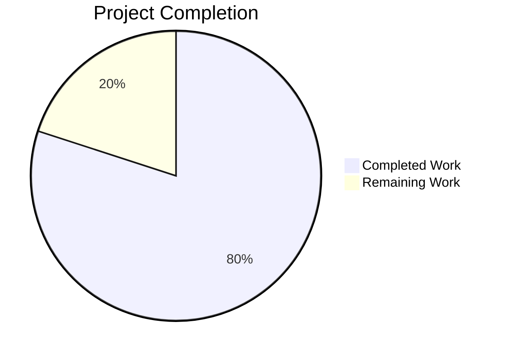
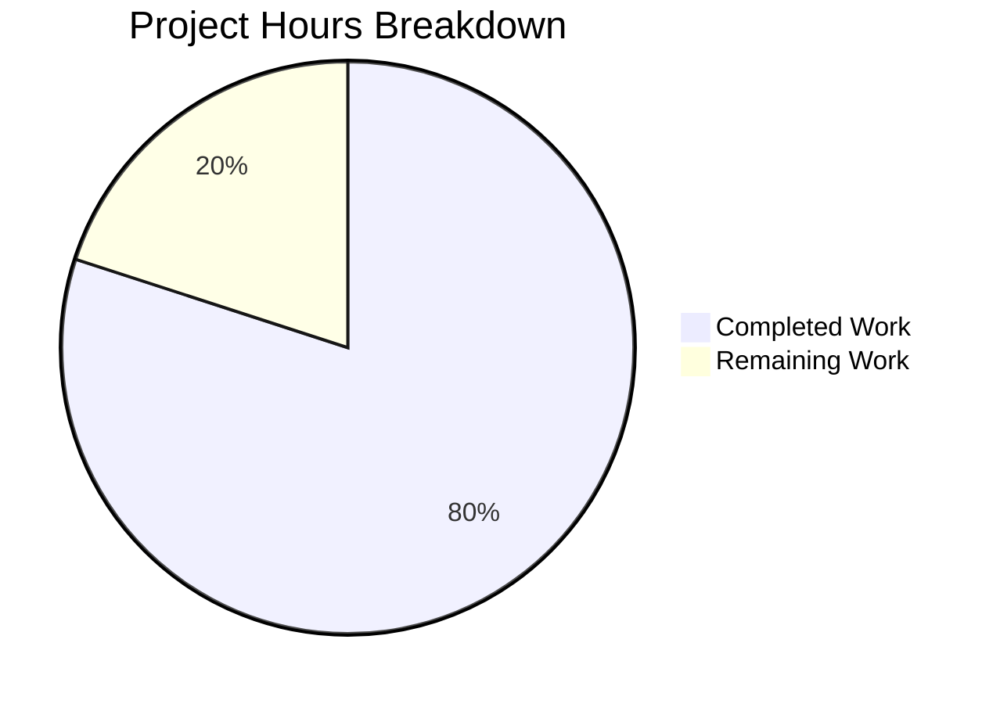

# 1. Executive Summary

## 1.1 Project Overview

A two-file, dependency-free Node.js command-line program delivered at the repository root. `index.js` prints exactly `Welcome to Blitzy` to standard output; `README.md` carries the run instruction. The target is any consumer that needs a minimal greeting on stdout — the smallest runnable Node.js program with no install step. Business impact is deliberately minimal: a zero-dependency, zero-configuration greeting that runs on whatever Node.js release is installed. Technical scope is one two-line JavaScript file and a four-line README, with no dependency, build step, test suite or configuration, delivered under a strict twelve-rule constraint set that caps both file sizes and forbids every additional artefact.

## 1.2 Completion Status



| Metric | Hours |
| --- | --- |
| Total Hours | 15.0 |
| Completed Hours (AI + Manual) | 12.0 |
| Remaining Hours | 3.0 |

**80.0% complete** — calculated as (12.0 completed / 15.0 total) × 100.

## 1.3 Key Accomplishments

- ✅ Greeting program: `index.js` prints exactly `Welcome to Blitzy` — verified 18-byte stdout, empty stderr, exit status 0.
- ✅ Unformatted output: no ANSI, colour or control byte in a pipe, on a terminal, or under a colour-forcing environment.
- ✅ Minimal source: two lines — one one-line JSDoc summary and one statement.
- ✅ Run instruction: `README.md` four lines, under the five-line cap, documenting the run command and that nothing installs.
- ✅ Zero dependencies: no manifest, lockfile, `node_modules` or registry resolution (`npm ls --depth=0` reports "(empty)").
- ✅ Byte-exact acceptance: both files match the specified content exactly (`index.js` 88 bytes, `README.md` 130 bytes).
- ✅ Deterministic and input-free: identical output under any arguments, environment, working directory or piped stdin.
- ✅ Rule compliance: no forbidden artefact anywhere in the tree — exactly the two deliverables are tracked.

## 1.4 Critical Unresolved Issues

**7 open items** remain of the 27 scoped requirements and path-to-production items.

| Issue | Impact | Owner | ETA |
| --- | --- | --- | --- |
| Cross-release Node.js execution unverified | Portability rests on source inspection, not a run | Platform / DevOps | Before merge |
| Branch unpublished (two commits ahead of main) | Nothing reaches `main` until pushed and merged | Development | Immediate |
| Human acceptance walkthrough pending | Release sign-off outstanding | QA | Before merge |
| Silent exit 0 when stdout cannot be written | A consumer cannot detect a failed write | Engineering (accepted) | Decided |
| No automated regression guard ships | A future edit to either file would drift undetected | Engineering (accepted) | Decided |
| Run instruction omits the runtime prerequisite and working directory | A subdirectory invocation exits 1 | Documentation (accepted) | Decided |
| `README.md` recorded as created but rewritten in place | Bookkeeping discrepancy only, no code impact | Delivery | On re-plan |

## 1.5 Access Issues

No access issues identified. The program reads no environment variable, binds no port, requires no service, credential or third-party API, and installs nothing.

## 1.6 Recommended Next Steps

1. **[High]** Publish and merge the branch — the work sits in two commits that origin does not yet hold (0.5 h).
2. **[Medium]** Run the documented gate (`node --check index.js && node index.js`) on the Node.js release line where the greeting will actually run (1.5 h).
3. **[Medium]** Complete the human acceptance walkthrough and record the accepted limits (1.0 h).
4. **[Low]** State the Node.js prerequisite and the working directory wherever the project is consumed.

# 2. Project Hours Breakdown

## 2.1 Completed Work Detail

| Component | Hours | Description |
| --- | --- | --- |
| Greeting program (`index.js`) | 2.0 | The one-line JSDoc summary and the single `console.log` statement that prints the exact string; the runtime choice and the two-line minimum satisfying both the comment constraint and the fewest-lines constraint. |
| Run instruction (`README.md`) | 1.5 | The four-line run instruction within the five-line cap, carrying the run command and the no-install statement, delivered in place at the same path. |
| Delivery-constraint adjudication | 2.5 | Applying and reconciling the twelve binding constraints and the three conflicts they raise, plus the forbidden-artefact inventory across manifest, lockfile, dependency, test, CI, container, docs, legal and badge classes. |
| Acceptance-criterion verification | 2.5 | Byte-exact comparison of both files against the specified content, line-count caps, trailing-byte and encoding checks, and the placeholder-removal check. |
| Runtime and security validation | 3.0 | Execution semantics and the consumer matrix (pipe, redirect, terminal, closed and full device), input-insensitivity matrices over arguments, environment, locale and working directory, determinism and concurrency runs, dependency and secret absence scans. |
| Delivery preparation | 0.5 | Root-level placement of both artefacts, tracked-file hygiene, clean working tree and commit history. |
| **Total** | **12.0** | |

## 2.2 Remaining Work Detail

| Category | Hours | Priority |
| --- | --- | --- |
| Execute the documented gate on the Node.js release line where the greeting will actually run, confirming the 18-byte output and exit status (AAP NFR2) | 1.5 | Medium |
| Publish the branch and merge the two delivered commits (path to production) | 0.5 | High |
| Human acceptance walkthrough against the acceptance criterion, and recording the accepted limits (path to production) | 1.0 | Medium |
| **Total** | **3.0** | |

# 3. Test Results

The project ships no committed test suite by design — the delivery constraints forbid a test file, framework, dependency or lockfile. The verification below is the acceptance evidence gathered by exercising the deliverables directly; every check listed was executed, and no check has been counted that was not run.

| Area / Category | Framework | Tests | Passed | Failed | Coverage | What This Proves |
| --- | --- | --- | --- | --- | --- | --- |
| Greeting output & process semantics | Node.js runtime checks | 6 | 6 | 0 | n/a | The program prints exactly `Welcome to Blitzy\n`, writes nothing to stderr and exits 0, reproducibly across runs. |
| Stream & format correctness | Node.js runtime checks | 3 | 3 | 0 | n/a | No ANSI, colour or control byte is emitted through a pipe, on a terminal, or under a colour-forcing environment. |
| Source structure & static parse | `node --check` (static parse) | 6 | 6 | 0 | n/a | The source is two lines / 88 bytes: one JSDoc line and one `console.log`, no shebang, no import or module syntax, no error handling, no pinned version. |
| Input & side-effect insensitivity | Node.js runtime checks | 4 | 4 | 0 | n/a | Output is identical under an empty environment, arbitrary arguments, unread stdin and a different working directory, and leaves the tree clean. |
| Run instruction (`README.md`) | Static file checks | 4 | 4 | 0 | n/a | The README is four lines / 130 bytes, the documented command reproduces the output, and it states the output and that nothing installs. |
| Acceptance criterion (byte equality) | Byte comparison | 2 | 2 | 0 | n/a | Both files are byte-exact against the specified content (88 B and 130 B). |
| Dependency-free & artefact absence | Dependency / artefact scan | 4 | 4 | 0 | n/a | `npm ls --depth=0` reports "(empty)", no forbidden artefact exists, and exactly two files are tracked. |

**Not Covered**

- No committed automated test suite exists by design — the constraints forbid a test file, test framework, lockfile and any dependency — so no regression guard ships with the deliverable. Any edit to either file must be re-compared against the acceptance criterion by hand.
- Cross-release behaviour is not exercised at runtime; only the single Node.js release line present on the build host (`v22.23.3`) was run. Portability rests on the source containing no version-gated syntax or API.
- No CI, lint or coverage tooling exists or may be added; the dependency and artefact scans above stand in for a package-manifest gate.
- The error paths were not asserted by any test: a closed stdout, a full output device and a broken pipe each exit 0 with no diagnostic (see Section 5.2 and Section 6).
- The subdirectory-invocation failure path (Node's `MODULE_NOT_FOUND`, exit 1) is not asserted by any test; the command is documented to run from the repository root.

# 4. Runtime Validation &amp; UI Verification

- ✅ **Program startup** — `node index.js` from the repository root starts and exits cleanly with status 0.
- ✅ **Primary output** — stdout receives exactly the 18-byte line `Welcome to Blitzy\n`.
- ✅ **Standard error** — empty (0 bytes) on every invocation.
- ✅ **Process exit status** — 0 across every run.
- ✅ **Output determinism** — 20 sequential runs collapse to a single stream digest.
- ✅ **Consumer matrix** — a pipe, a file redirect and a terminal capture all yield the same line (a terminal adds only the kernel's newline translation).
- ✅ **Input-insensitivity** — an empty environment, arbitrary arguments, unread stdin and a different working directory all yield identical output.
- ⚠ **Error write path** — a closed stdout, a full output device and a broken pipe each exit 0 with no diagnostic; accepted, since no error handling was requested.
- ⚠ **Subdirectory invocation** — `node index.js` away from the repository root fails with Node's `MODULE_NOT_FOUND`, exit 1; expected, the command runs from the root.
- ⚠ **Direct execution** — `./index.js` exits 126 Permission denied; expected, the program is invoked through the node binary as documented.

**Never exercised at runtime.** No user interface, screen, HTTP endpoint, database or external integration was driven, because the project has none: it performs a single write to stdout and exits. There is no browser surface to validate. Cross-release behaviour was not exercised — only the Node.js release line present on the build host was run (see Section 3).

# 5. Compliance &amp; Quality Review

## 5.1 Compliance Matrix

| Deliverable / Requirement | Source | Status | Progress |
| --- | --- | --- | --- |
| Greeting printed exactly `Welcome to Blitzy` | AAP FR1 | ✅ Pass | 100% |
| Output is unformatted (no colour, label or banner) | AAP FR2 | ✅ Pass | 100% |
| Fewest lines / one top-level statement | AAP FR3 | ✅ Pass | 100% |
| One-line JSDoc summary | AAP FR4 / Rule 3 | ✅ Pass | 100% |
| Run instruction under 5 lines | AAP FR5 / Rule 4 | ✅ Pass | 100% |
| Zero dependencies (no manifest, lockfile, `node_modules`) | AAP NFR1 / Rule 5 | ✅ Pass | 100% |
| Runs on whichever Node.js release is installed | AAP NFR2 | ⚠ Pass (partial) | Source-level met; cross-release execution not exercised |
| No input and no side effects | AAP NFR3 | ✅ Pass | 100% |
| Exact stated contents are the acceptance criterion | AAP NFR4 | ✅ Pass | 100% |
| No formatting machinery | AAP NFR5 | ✅ Pass | 100% |
| Smallest possible diff; create no other file | Rules 1–2 | ✅ Pass | 100% |
| Two root-level files; boundary stated once | Rule 12 / AAP 0.6.1 | ⚠ Pass with note | End state met; README.md is an in-place rewrite |

## 5.2 AAP &amp; Rule Divergences and Gaps

| What the AAP/Rule Required | What Was Delivered Instead | Why It Diverged | Impact | Remediation |
| --- | --- | --- | --- | --- |
| `README.md` recorded as a CREATE and the change as purely additive, touching no existing file | `README.md` rewritten in place (git `M`, +4/−2) | A tracked placeholder `README.md` already existed at that path; the AAP's own conflict resolution makes the README an intended deliverable and Rule 4 requires it | Bookkeeping only | None required for the deliverable; reconcile the plan wording if the change is ever re-planned |
| The change lands as a single atomic step | Two commits (one per file) | Each file was written and committed separately | None | None |
| Generic pre-commit lint step | No linter run or introduced | No linter or manifest exists; Rules 2 and 5 forbid adding either | None on the deliverable | None — sanctioned |
| Generic "commit ad-hoc tests" step | No test, fixture or harness committed | Rules 5 and 11 forbid any committed verification artefact | No regression guard ships | None — sanctioned |
| Generic scripting check: fail loudly rather than exit 0 | Closed stdout, full device and broken pipe each exit 0 with no diagnostic | Rule 6 forbids a handler; the program is specified to have no error path | A consumer cannot distinguish "wrote nothing" from "could not write" | None permissible; consumers should assert the line, not the exit status |
| Generic CLI expectations: shebang, executable bit, help/usage, argument handling | No shebang, no executable bit, `--help`/`--version` ignored | The documented invocation is `node index.js`; Rules 2 and 6 forbid extra artefacts and the fewest-lines cap fixes two lines | The file runs through the node binary only | None — sanctioned |
| Run instruction complete enough to run unaided | `README.md` states neither the runtime prerequisite nor the working directory, and lines 3–4 render as one paragraph | The exact four lines are pinned verbatim by the acceptance criterion under Rule 4's cap | A reader must infer the prerequisite and the working directory | Closing it would change pinned content; document both where the project is consumed |

**DV-1 — `README.md` rewrite vs. recorded creation.** The plan recorded `README.md` as a new file and the change as purely additive, but the repository already tracked a two-line Blitzy placeholder at that path (`README.md:1-2` on the base commit `7e794da`). The delivered `README.md` replaced it in place, so git records a modification (`+4/−2`) rather than an addition. The content is byte-exact against the specified four lines and satisfies Rule 4's line cap; the divergence is bookkeeping, with no functional, security or performance effect. A human need do nothing to the deliverable — the wording is the only thing that would change if the plan is ever reconciled.

**DV-2 — two commits vs. one atomic step.** The plan staged the change as a single atomic step; it landed as two commits, `92dc400` (adding `index.js`) and `68bcb1f` (documenting the run instruction in `README.md`). Each file was written and committed separately, so the history is two commits rather than one. Both files are complete and consistent at the branch head, so nothing downstream depends on the split. No remediation is needed; a human merging the branch will simply see two commits.

**DV-3 — no linter.** No linter was introduced or run. The repository ships no linter and no manifest, and Rules 2 and 5 forbid adding a dependency or an extra file, so an automated style gate cannot exist without violating them. The deliverable is unaffected — the source is two lines, one comment and one statement — but style defects would not be caught mechanically. This is a sanctioned decision: nothing is owed to close it, and none should be added.

**DV-4 — no committed test artefact.** No test file, fixture or harness was committed, because Rules 5 and 11 forbid a test suite, a test file and any committed verification apparatus; validation was performed outside the repository and removed. The consequence is that the branch ships with no automated regression guard: a future edit to either file would drift undetected unless it is re-compared against the acceptance criterion. This is sanctioned — the acceptance criterion is byte equality, which a human can check directly — and no work is owed.

**DV-5 — silent success on a failed write.** When stdout is closed, pointed at a full device, or broken by an early-exiting consumer, the program exits 0 with no diagnostic: the write fails and nothing signals it. Rule 6 forbids an error handler, try/catch, logging or any hardening not explicitly requested, and the program is specified to have no error path, so this behaviour is intentional rather than a defect. The impact is that a consumer cannot tell "wrote nothing" from "could not write". Nothing may be added to close it; consumers should assert the 18-byte line rather than the exit status.

**DV-6 — no CLI surface.** The file carries no shebang and no executable bit, so `./index.js` exits 126 Permission denied, and arguments such as `--help` and `--version` are ignored with no usage output. The documented invocation is `node index.js`; Rules 2 and 6 forbid adding a shebang or an extra file, and the fewest-lines constraint fixes the source at two lines. This is sanctioned — the program is run through the node binary exactly as documented — and no remediation is owed.

**DV-7 — run instruction leaves prerequisites implicit.** `README.md:3-4` state neither the Node.js prerequisite in words nor that the command must be issued from the repository root, and under CommonMark the two prose lines reflow into one paragraph. The exact four lines are pinned verbatim by the acceptance criterion under Rule 4's five-line cap, so correcting the wording would mean changing the pinned content. The impact is that a reader must infer the runtime and the working directory — a subdirectory invocation exits 1 with `MODULE_NOT_FOUND`. A human should state both wherever the project is consumed.

# 6. Risk Assessment

| Risk | Category | Severity | Probability | Mitigation | Status |
| --- | --- | --- | --- | --- | --- |
| No automated regression guard ships — a future edit to either file could drift undetected | Technical | Medium | High | The acceptance criterion is byte equality; keep both files' digests in review and re-compare on any edit | Accepted by the delivery constraints |
| Cross-release portability is evidenced, not executed — only one Node.js release line was run | Technical | Low | Low | The source is one comment and one `console.log` with no version-gated construct; run the documented gate on the deployment line | Open — remaining task (1.5 h) |
| A write that cannot land is silent — a closed stdout, full device or broken pipe exits 0 with no diagnostic | Operational | Low | Medium | None permissible (no hardening was requested); consumers should assert the 18-byte line rather than the exit status | Accepted with a caveat |
| The run instruction leaves the runtime prerequisite and the working directory implicit | Operational | Low | Medium | State the invocation where the project is consumed; note that a subdirectory invocation exits 1 | Accepted with a caveat |
| Delivery metadata records `README.md` as created where it was rewritten in place | Operational | Low | Low | Reconcile the plan wording if the change is re-planned; no code impact | Accepted |
| The program depends on a `node` reachable on `PATH` — no manifest, wrapper or absolute interpreter path | Integration | Low | Low | The deployment environment must provide Node; `node index.js` from the repository root is the only documented entry point | Open — environment-owned |
| No untrusted-input surface exists today; any future change adding input handling would create one | Security | Low | Low | Hold the two-line, input-free design; if input is introduced, design validation and an error policy with it | Open — design guardrail |

Seven risks total; none is critical or high severity. There is no dependency to compromise, no secret to leak and no persistence to corrupt, because the project performs a single write to stdout and exits.

# 7. Visual Project Status



**Remaining work by category**

| Category | Hours |
| --- | --- |
| Cross-release execution on the deployment Node.js line | 1.5 |
| Publish and merge the branch | 0.5 |
| Human acceptance walkthrough | 1.0 |
| **Total** | **3.0** |

The project stands at **80.0% complete** — 12.0 hours delivered against a 15.0-hour total. The 3.0 hours of remaining work is release and verification labour, not unfinished build: the two-file deliverable itself is complete and byte-exact.

# 8. Summary &amp; Recommendations

The project delivers a two-file, dependency-free Node.js command-line program at the repository root. `index.js` prints exactly `Welcome to Blitzy` to standard output through a single `console.log` preceded by a one-line JSDoc summary, and `README.md` carries the four-line run instruction within the five-line cap. Both files are byte-exact against the specified content — `index.js` at 88 bytes and `README.md` at 130 bytes — and no other artefact exists in the tree: no manifest, lockfile, dependency, test, CI configuration or container file.

Verification exercised the deliverable directly rather than through a committed suite, which the constraints forbid. The program prints exactly `Welcome to Blitzy\n` (18 bytes) with empty stderr and exit status 0; the output is identical across a pipe, a redirect and a terminal and carries no colour or control byte even under a colour-forcing environment; it is invariant to arguments, environment, working directory and stdin; twenty runs collapse to one digest; and both files were confirmed byte-for-byte against the acceptance criterion. Twenty-nine checks were run and all passed.

The project is **80.0% complete**: 12.0 of 15.0 total hours delivered, with 3.0 hours remaining. The remaining work is release and verification labour, not unfinished build. The critical path is short — publish and merge the two commits the branch carries ahead of `main` (0.5 h), execute the documented gate on the Node.js release line where the greeting will actually run (1.5 h), and complete the human acceptance walkthrough that records the accepted limits (1.0 h). The first of these is the only step blocking the work from reaching `main` at all.

Production readiness is high for a program of this scope. The deliverable is complete, deterministic, dependency-free and fully within its constraints. The open items are accepted limits rather than defects: a write that cannot land is silent by design, no automated regression guard ships because none may, and the run instruction leaves the runtime prerequisite and working directory implicit because its content is pinned. Each is recorded so a maintainer inherits it knowingly rather than by surprise.

| Metric | Value |
| --- | --- |
| Completion | 80.0% (12.0 / 15.0 hours) |
| Deliverables | 2 files, both byte-exact |
| Dependencies | 0 |
| Checks passed | 29 / 29 |
| Open items | 7 (3 with remaining work, 4 accepted limits) |
| Blocking step | Publish and merge the branch |

# 9. Development Guide

## System Prerequisites

- **Node.js** — any installed release. The verification environment ran `v22.23.3`; the source uses no version-gated syntax or API.
- **No other tooling** — no package manager step, compiler, bundler or database is required.

Verify the runtime is available:

```bash
node -v
# e.g. v22.23.3
```

## Environment Setup

Nothing to configure. The program reads no environment variable, opens no socket, and requires no working directory other than the repository root. Run all commands from the repository root:

```bash
cd <repository-root>
```

## Dependency Installation

There are none. Zero dependencies are declared and none are needed:

```bash
npm ls --depth=0
# <path>
# └── (empty)
```

Do **not** run `npm install`, and do not add a `package.json`, lockfile, dependency, test file, linter or any other scaffolding — the project's constraints forbid each of them.

## Application Startup

The program is a single file run directly through the node binary:

```bash
node index.js
```

Expected: stdout receives exactly `Welcome to Blitzy` followed by one newline (18 bytes); stderr is empty; exit status is 0. There is no server, no port and no long-running process.

## Verification Steps

Static parse, then run — the full gate for the whole package, which is one file:

```bash
node --check index.js && node index.js
# Welcome to Blitzy
```

Confirm the exact output and exit status:

```bash
test "$(node index.js)" = "Welcome to Blitzy" && echo MATCH
# MATCH
```

## Example Usage

Capture the output and run the command the README documents:

```bash
node index.js > out.txt
wc -c out.txt          # 18
od -c out.txt          # W e l c o m e   t o   B l i t z y \n
grep -o 'node index.js' README.md   # node index.js
```

## Troubleshooting

| Symptom | Cause | Resolution |
| --- | --- | --- |
| `Cannot find module '<root>/blitzy/index.js'` (code `MODULE_NOT_FOUND`, exit 1) | `node index.js` run from a subdirectory | Run the command from the repository root |
| `npm error code ENOENT ... Could not read package.json` (exit 254) | There is deliberately no `package.json` and no test suite | Expected — do not add a manifest; use the `node` commands above |
| `./index.js` → exit 126 Permission denied | No shebang and no executable bit | Invoke through the node binary: `node index.js` |
| Exit 0 but nothing appears on stdout | stdout could not be written (closed, a full device, or a broken pipe) | Assert the 18-byte line rather than the exit status; no diagnostic is emitted by design |
| `node: command not found` | Node.js is not on `PATH` | Install Node.js or add it to `PATH`; the program has no bundled runtime |

# 10. Appendices

## A. Command Reference

| Command | Purpose |
| --- | --- |
| `node index.js` | Run the greeting; prints `Welcome to Blitzy` and exits 0 |
| `node --check index.js` | Static syntax parse of the source (exit 0 = parses) |
| `node --check index.js && node index.js` | The full gate for the package |
| `test "$(node index.js)" = "Welcome to Blitzy" && echo MATCH` | Assert exact output |
| `npm ls --depth=0` | Confirm zero dependencies ("(empty)") |
| `git ls-files` | Confirm exactly the two deliverables are tracked |

## B. Port Reference

None. The program binds no TCP or UDP port and starts no service, container, database or queue.

## C. Key File Locations

| Path | Role |
| --- | --- |
| `index.js` | The program — two lines, prints the greeting (88 bytes) |
| `README.md` | The run instruction — four lines (130 bytes) |

Both files sit at the repository root; the root placement is what makes the documented command `node index.js`.

## D. Technology Versions

| Component | Version |
| --- | --- |
| Node.js (verification environment) | v22.23.3 |
| npm (verification environment) | 11.21.0 |
| Index source | 2 lines, 88 bytes, ASCII |
| README | 4 lines, 130 bytes (includes one U+2014 em dash) |

## E. Environment Variable Reference

None. The program reads no environment variable and is unaffected by locale, terminal type or colour-forcing variables.

## F. Developer Tools Guide

The project requires no linter, formatter, test runner, bundler or CI configuration, and none may be added under the delivery constraints. A change is validated by static-parsing and running `index.js`, then re-comparing both files byte-for-byte against the acceptance criterion:

```bash
node --check index.js && node index.js
sha256sum index.js README.md
# index.js  ca8c33d67b4feda46fa23e7538bb3f429dc7dab8480855323c32a06049f34165
# README.md acc7f208c6d330c3320a7c351c8048fb36af079f882e6a7e419e684b3fc3e356
```

## G. Glossary

| Term | Meaning |
| --- | --- |
| Acceptance criterion | The specified byte-exact contents of `index.js` and `README.md`; equality to it is the definition of done |
| Gate | `node --check index.js && node index.js` — the static parse plus the run |
| Digest | A SHA-256 hash of a file's bytes, used to detect any drift |
| JSDoc summary | The single-line `/** ... */` comment on `index.js:1` |
